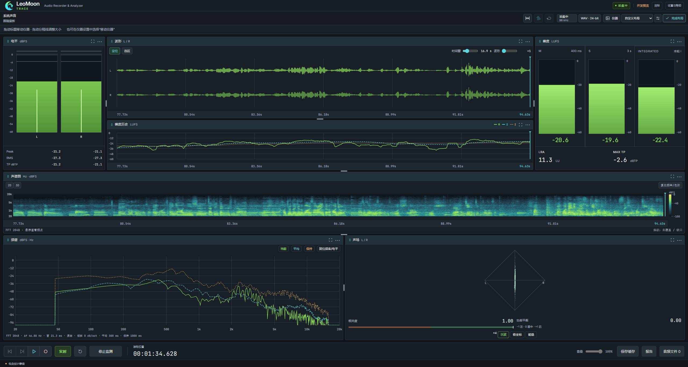
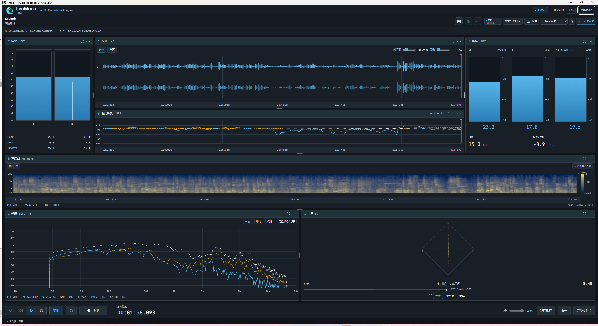

<div align="center">


# LeoMoon · TRACE

**Trace 声迹 · 音频分析录音机**

Audio Recorder & Analyzer

录下系统声音，回到每个细节。

[下载 Windows 测试版](https://github.com/Sceneryyyy/Trace/releases/tag/v0.1.0-preview.35-it1) · [快速上手](docs/internal-test/START-HERE.md) · [使用说明](docs/28-USER-GUIDE.md) · [反馈问题](https://github.com/Sceneryyyy/Trace/issues)

</div>

Trace 是 LeoMoon 系列面向 **Windows 桌面**的音频录音与分析工具。它将系统声音采集、录音、回听和测量仪器放在同一个工作台：你可以观察正在播放的声音，保存刚才错过的片段，也可以沿时间轴定位、试听和分析录音中的细节。

录音与分析在本机完成，支持离线使用。波形、响度历史与频谱视图围绕同一段声音协同工作，帮助你将听感与具体时刻的测量结果对应起来。



*用户提供的 Trace 工作台截图，展示自定义布局与绿色主题。布局与控件以下载版本为准。*

<details>
<summary>查看蓝色主题工作台</summary>



</details>

## 适合用来做什么

- **捕捉系统声音与灵感片段**：录制所选播放设备的输出；即使没有提前按下录音，也能从监测缓存中保存最近的片段。
- **检查游戏音效与交互声音**：结合波形、响度、频谱和声场，检查瞬态、动态变化与立体声表现。
- **复核配音、音乐和参考素材**：导入音频，按时间范围查看响度与峰值，通过 A/B 对比和报告记录差异。

## 主要能力

| 能力 | 可以完成的工作 |
| --- | --- |
| 实时监测 | 未录音时也能观察滚动波形、电平、响度和频谱；监测与录音分别控制 |
| 录音与缓存保存 | 录制为 WAV，或在停止后生成 MP3/AAC；监测历史在内存中保留最多约 60 秒，可显式保存缓存或选区 |
| 时间轴与回听 | 波形和响度历史共用游标；停止录音后定位回听、调整选区并循环试听，检查同一时刻的历史读数 |
| 音频测量与可视化 | Peak、RMS、True Peak，M/S/I 响度与 LRA；频谱、2D/3D 声谱图，以及立体声声场、相关度和平衡 |
| 素材比较与复核 | 导入外部音频、A/B 参考比较、响度目标、标记与评论；导出 CSV/HTML 测量报告和 SVG/PNG 频谱、声谱图 |
| 自定义工作台 | 选择显示的仪器，调整位置与尺寸，保存布局预设，并切换仪表主题 |

监测缓存保存在内存中，只有开始录音或执行“保存缓存”时才写入音频文件。查看历史可以与录音同时进行；发声回听需先停止录音。

### 录音与导出格式

| 格式 | 位深 / 码率 | 采样率 |
| --- | --- | --- |
| WAV | 16-bit / 24-bit PCM、32-bit float | 跟随真实来源，或选择 44.1 / 48 / 88.2 / 96 kHz |
| MP3 | 128 / 192 / 256 / 320 kbps CBR | 44.1 / 48 kHz |
| AAC-LC | 128 / 192 / 256 kbps；M4A 或 ADTS | 44.1 / 48 kHz |

支持单声道与双声道。实际采集率取决于设备及系统音频格式；需要重采样或压缩时，停止录音后生成独立成品。原始 WAV 默认保留，便于继续分析和制作其他格式。

## 下载与开始使用

在 [GitHub Releases](https://github.com/Sceneryyyy/Trace/releases) 获取测试包与校验文件。当前下载为 [preview.35 · Internal Test 1](https://github.com/Sceneryyyy/Trace/releases/tag/v0.1.0-preview.35-it1)，适用于 Windows x64。

1. 下载 `Trace-preview.35-IT1-Test-Kit.zip`，完整解压，阅读其中的 `START-HERE.md`。测试包同时提供匹配源码、依赖许可和反馈材料。
2. 再解压其中的 `Trace-0.1.0-preview.35-IT1-Windows-x64.zip`，运行 `Trace.exe`，保留应用目录内的配套文件。
3. 选择系统播放设备，在“设置与帮助 → 录音与保存”中选择录音目录与格式。开始监测并播放声音，即可观察仪器。
4. 点击录音按钮开始录制；停止后，从“音频文件”打开录音进行定位、回听、选区循环或导出。
5. 点击“实时”回到最新声音。需要保留尚未录制的片段时，使用“保存缓存”；需要检查已有音频时，通过“导入”载入外部素材。

> 当前提供的是未签名的预发布测试版。首次使用请阅读[已知问题](docs/internal-test/KNOWN-ISSUES.md)；更换版本时先正常退出旧程序，并将新包解压到独立目录。macOS 暂无可用分发包。

详细操作见[使用说明](docs/28-USER-GUIDE.md)。参加内测可按[测试矩阵](docs/internal-test/TEST-MATRIX.md)选择适合自己设备的检查项目。

## 反馈与交流

欢迎通过 [GitHub Issues](https://github.com/Sceneryyyy/Trace/issues) 提交问题和使用建议。反馈时请说明软件版本、Windows 版本、采集设备与采样率、复现步骤以及预期和实际表现，可直接使用[反馈模板](docs/internal-test/FEEDBACK.md)。

“设置与帮助 → 帮助与诊断”提供诊断导出，也可以通过邮件 **472841772@qq.com** 反馈。分享前请检查内容，个人录音无需公开上传。

## 开发与文档

Trace 使用 Electron、React 与 TypeScript 构建桌面界面，原生 C++ / WASAPI 处理 Windows 音频采集与回放，libebur128 负责响度计量，FFmpeg 处理格式转换。

使用项目要求的 Node/npm 版本，在仓库根目录安装锁定依赖并执行基础检查与构建：

```bash
npm ci
npm run typecheck
npm test
npm run build
```

Windows 原生引擎和分发包还需准备 C++ 工具链及音频依赖，按 [Windows 开发环境说明](docs/09-WINDOWS-SETUP.md)操作。固定版本见[工具链清单](toolchain.trace.json)。

- [产品范围](docs/01-PRODUCT.md)与[架构说明](docs/02-ARCHITECTURE.md)：了解产品设计和模块边界。
- [文档索引](docs/README.md)：查找操作、开发和测试资料。
- [开发交接](docs/13-HANDOFF.md)与[任务单](docs/07-BACKLOG.md)：查阅开发进度和待办；[验收清单](docs/76-RELEASE-CHECKLIST.md)记录验证范围。

## 许可与来源

Trace 基于 [Boof2015/Prism](https://github.com/Boof2015/prism) 开发，复用起点为提交 `df0755b8caaaab85157ac51aefffca0526974fc1`。感谢 Prism 作者及相关开源项目。

项目遵循 [GNU GPL v3](LICENSE)，保留[第三方声明](THIRD_PARTY_NOTICES.md)、[上游原始 README](README-Prism.md)和[来源记录](docs/archive/iterations/14-SOURCES.md)。Trace 的功能与使用方式以本页及项目文档为准。
