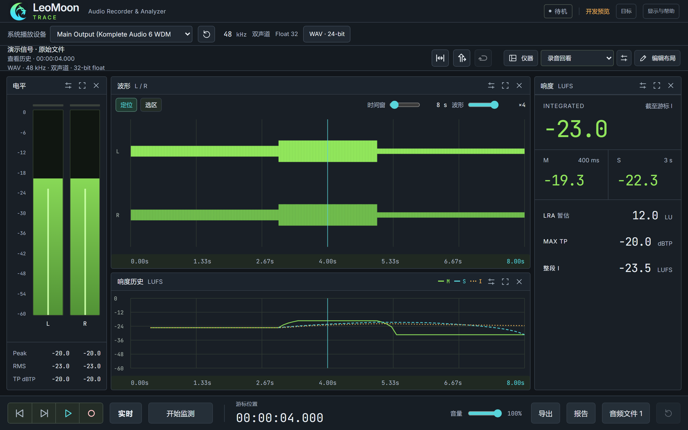

<div align="center">


# LeoMoon · TRACE

**Trace 声迹 · 音频分析录音机**

Audio Recorder & Analyzer

让声音被看见，让灵感有迹可循。

[快速上手](docs/28-USER-GUIDE.md) · [内测版本说明](docs/69-INTERNAL-TEST-R3.md) · [开发进度](docs/13-HANDOFF.md) · [文档索引](docs/README.md) · [许可与来源](#许可与来源)

</div>

Trace 是 LeoMoon 系列的桌面音频录音与分析工作台。它把系统声音采集、录音、历史回听和多种测量仪器放在同一个窗口，让你既能观察正在发生的声音，也能沿时间轴回到刚才的细节。

当前源码为 **0.1.0-preview.31**，开发分支为 `recorder/dev`。最近完成打包验证的版本仍是 **Windows x64 0.1.0-preview.30 / InternalTest-r3**（来源提交 `9c1ee21`）；preview.31 Windows 包尚未打包；[新版 PDF 快速上手](output/pdf/LeoMoon-Trace-Quick-Start-preview.31-zh-CN.pdf) 已更新，界面插图明确使用云端模拟数据。macOS 移植方案已记录，当前分支的 Trace 音频后端仍为 Windows/WASAPI，Mac 采集实现与实机验收尚未完成。



*界面截图来自 preview.28 的演示信号；当前内测包为 preview.30。*

## 功能特点

- **系统声音录音**：选择 Windows 播放设备，捕获该设备输出的声音；支持 WAV、MP3、AAC。WAV 提供 16/24-bit PCM 和 32-bit float，压缩格式提供质量或码率选项。
- **留住刚才的声音**：监测时在内存中保留最多 60 秒历史，可定位回看与回听，或显式保存缓存及选区。无需提前开启录音；普通监测不会写入音频临时文件。
- **统一时间轴**：波形与响度历史共享游标，支持拖动定位、选区循环、跟随游标及波形复位。实时监测、历史查看和文件回听在同一工作台完成。
- **多仪器分析**：电平、Peak/RMS/True Peak，M/S/I 响度及 LRA，频谱、2D/3D 声谱图，以及立体声声场、相关度和平衡。
- **按任务组织界面**：选择要显示的仪器，编辑位置与尺寸，保存命名布局预设；从精简录音视图切换到完整分析工作台。
- **素材检查与参考比较**：导入外部音频，用 A/B 参考对比观察差异；设置响度目标，查看超限事件，导出 CSV/HTML 测量报告。
- **本地文件与诊断**：管理录音、原件与导出成品，提供单实例保护、脱敏诊断导出和邮件反馈入口。

## 设计理念与使用场景

**以时间轴串起听觉与测量。** 读数跟随正在查看的位置，帮助你把“听起来有什么问题”对应到“哪一段发生了什么”。监测与录音分开控制，仪器按任务配置，常用走带操作集中在底部。

适合游戏音效和交互声音检查、系统声音与灵感片段采集、配音及音乐素材的响度复核，以及与参考素材进行频谱和声场比较。

## 快速开始

1. 获取 **Windows x64 内测分发包**，完整解压后运行 `Trace.exe`。当前包名、内容与校验信息见 [InternalTest-r3 分发说明](docs/69-INTERNAL-TEST-R3.md)；当前分发包由维护者另行提供。
2. 选择系统播放设备，点击「开始监测」并播放声音，观察仪器；也可以直接点击录音按钮启动采集和录音。
3. 点击停止录音后，在波形上定位回听；切换「选区」后拖出范围，启用循环试听。
4. 点击「实时」回到最新声音。需要保留尚未录制的片段时，使用「保存缓存」。
5. 通过「仪器」选择显示内容，再进入「编辑布局」调整工作台并保存预设。

详细操作见 [用户指南](docs/28-USER-GUIDE.md)。内测分发包包含中文 PDF 快速上手手册，手册的适用版本与维护说明见 [用户手册记录](docs/62-USER-MANUAL.md)。

### 当前验证边界

本项目仍处于开发预览阶段。preview.30 有历史 Windows 自动化及打包证据；preview.31 的最新修复已通过 Linux 云端类型、可移植测试和应用资源构建，Windows 原生重编译与真实设备复验尚未执行。独立干净 Windows、不同声卡/驱动、真实 96 kHz 等验收仍需补充；Windows 分发包尚未签名。macOS 采集、权限、打包与签名/公证尚未完成实机验证。云端 CI/打包/退出与依赖收尾见 [75](docs/75-CLOUD-RELEASE-PREPARATION.md)，正式发布门禁见 [76](docs/76-RELEASE-CHECKLIST.md)。当前仍有 Electron/打包原生链安全公告待处理；具体证据与待办以 [当前交接记录](docs/13-HANDOFF.md) 为准。

Meter v5 的适用 EBU 原始 WAV 已在云端通过 68/68；响度索引和报告峰值修复见 [78](docs/78-EBU-METER-RECALIBRATION.md)，Windows 新引擎/实际文件路径与设备验收仍待补充。

## 开发入口

Trace 使用 Electron / React / TypeScript，Windows 音频后端使用原生 C++ / WASAPI，计量使用 libebur128，格式转换使用 FFmpeg。项目采用锁定依赖和本地构建工具，准备环境时先阅读 [工具链记录](toolchain.m0.json) 与 [开发交接](docs/13-HANDOFF.md)。

在仓库根目录的 Windows PowerShell 中执行：

```powershell
.\Trace.ps1 -Action Setup     # 准备依赖与上游原生模块
.\Trace.ps1 -Action Engine    # 构建 Trace 音频引擎
.\Trace.ps1 -Action Check     # 类型检查与针对性测试
.\Trace.ps1 -Action AppBuild  # 构建 Trace 应用
.\Trace.ps1 -Action App       # 启动开发构建
.\Trace.ps1 -Action Package   # 构建 Windows 分发包
```

构建所需的 Node、Python、Visual Studio C++ 等版本以工具链和项目文档为准；上述入口不会代替系统构建工具的安装。

| 入口 | 内容 |
| --- | --- |
| `src/trace/` | Trace 界面、主进程与业务逻辑 |
| `native/src/recorder/` | 原生录音、缓存、计量与回放核心 |
| [产品需求](docs/01-PRODUCT.md) / [架构](docs/02-ARCHITECTURE.md) | 产品范围与技术约定 |
| [任务单](docs/07-BACKLOG.md) / [迭代计划历史](docs/38-DEVELOPMENT-PLAN.md) | 当前待办与 M7–M12 原始范围 |
| [验收标准](docs/08-ACCEPTANCE.md) / [当前交接](docs/13-HANDOFF.md) | 验证证据、限制和下一任务 |

Trace 文档集中维护在 `docs/`，阅读顺序见 [文档索引](docs/README.md) 与 [开发入门](CODEX-START.md)。`recorder/dev` 为默认开发分支；macOS 路线见 [移植方案](docs/70-MACOS-PORT-PLAN.md)。上游复用起点以提交和来源记录追溯，不依赖本地是否存在 `main` 分支。

## 反馈

内测反馈请说明软件版本、Windows 版本、声卡/设备、复现步骤、预期与实际表现。可以从软件中导出脱敏诊断文件，经检查后附在邮件中发送至 **472841772@qq.com**；音频素材仅在你愿意分享时提供。

## 许可与来源

Trace 基于 [Boof2015/Prism](https://github.com/Boof2015/prism) 开发，复用起点为提交 `df0755b8caaaab85157ac51aefffca0526974fc1`。感谢 Prism 作者及相关开源项目。

项目保留 [GNU GPL v3 许可](LICENSE)、[第三方声明](THIRD_PARTY_NOTICES.md) 与 [上游原始 README](README-Prism.md)。详细来源与复用记录见 [来源清单](docs/14-SOURCES.md)。上游 README 描述的是 Prism 的历史功能与构建流程，Trace 的功能及开发入口以本页和 `docs/` 为准。
