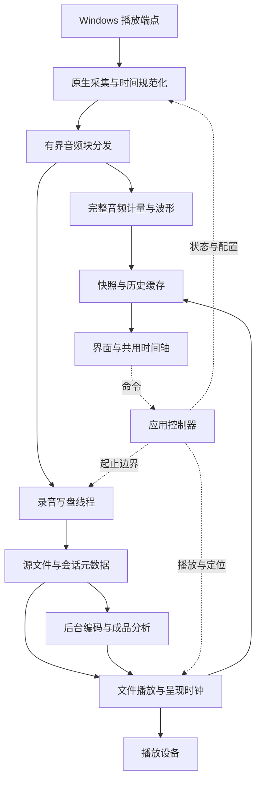

# 02 · 架构与模块边界

2026-09-24：原 Windows/WASAPI 架构保持现状；已选定的 Mac 扩展按 [ADR-012](11-DECISIONS.md) 与 [70-MACOS-PORT-PLAN](70-MACOS-PORT-PLAN.md) 在采集、输出、文件操作和打包处增加平台后端。下方 Windows 图和原始默认路线不表示 Mac 实现已完成。

PB1/PB2：userData 规范化后、引擎/录音库初始化前取得 Electron 单实例锁。SupportJournal/SupportRuntime 在主进程管理有界诊断与故障恢复入口；React RecoveryBoundary 提供最小可操作界面。录音仍使用原生线程与既有恢复日志，界面重载不重启引擎。见 [60](60-PB1-PB2-SUPPORT.md)。

M12：ImportService 管理只读外部素材、四项准备队列、源变化/取消/重建/归档；AssetRepository 组合录音与导入来源，ExportService/DeliveryService 依赖窄的 ExportOwner。原始录音生命周期保持独立，源解析后复用既有文件分析/回放/仪器/报告。拖放通过 File 对象与专用 preload 通道，接口和验证见 53；参考数据与调度设计见 54；ReferenceService、独立数组流和 NativeAnalysisQueue 已接入，验证见 55。两项 native 执行/四项等待只用于分析，采集与写盘不进入队列。

M11：ReportService 管理独立进程、有界任务队列、源引用、取消/重试及报告导出；report-worker 按页读原分析缓存并分块写 CSV/HTML。目标设置独立于布局/分析，目标比较不改变基础测量。应用清理/删除来源前等待报告释放；REC 优先。实现与待验范围见 [51](51-M11-INTEGRATION.md)。

2026-09-17 当前架构入口：后续目标与完成条件见 [38](38-DEVELOPMENT-PLAN.md)。M7 使用 React 分割树和独立 workspace 配置；M8 已把频谱与声场接入统一来源/呈现/选区，见 [41](41-M8-METERING.md)/[42](42-M8-ACCEPTANCE.md)。显隐与停靠不控制音频生命周期，隐藏窗口的呈现调度见 [45](45-VISIBILITY-AND-RESOURCE-GATE.md)。M9 原生瓦片、有界存储、来源服务/显示聚合及共轴 2D 已接入。大数组采用独立呈现流，来源关闭等待查询释放；设计见 [43](43-M9-SPECTROGRAM.md)，preview.15 接入和待验项目见 [46](46-M9-2D-INTEGRATION.md)。

M7 结构、上游复用审计和资源预算见 [39-M7-WORKSPACE](39-M7-WORKSPACE.md)。以下首版设计及历史状态保留追溯；实际包/源码身份和未关闭门禁以 13 为准，不把上游模块或规划接口的存在视为 Trace 已交付功能。

preview.4：PlaybackService 分离只读历史上下文与按需音频输出。打开文件/固定缓存不打开声卡、不停止输入；主进程始终观察录音和源状态。见 31。

2026-09-16 更新：M6 已建立 Trace 专用独立包、保留策略与桌面交互收尾；开发预览和验证边界见 27。

状态（2026-09-15）：M0/M1/M2 已过最小工程关口；M2 的录音、会话、转换/恢复及 30 分钟实录/重开通过。当前实际映射为 src/trace 和 native/src/recorder；FILE 播放/历史/选区已接通并通过 M4 最小工程门禁，见 25；Export/有损成品解码已接通，见 26；桌面交付与完整交互待 M6。M3 原始 EBU 素材门禁仍开放。以下架构是完整目标，未接通部分不能按已实现理解。

## 默认技术路线

先在独立仓库检出 Prism `df0755b8caaaab85157ac51aefffca0526974fc1`，保留可复用的 Windows 设备枚举、WASAPI 接线及 React 面板，增加独立的连续录音和回放领域层。桌面壳沿用 Electron/React/TypeScript，音频路径使用 C++，统一计量使用 libebur128，格式转换使用固定构建的 FFmpeg。不要先升级整套前端或把业务功能嫁接到 vstdev。

Prism 是优先验证对象，不是“无需改造”的保证。M0 通过条件和 NAudio/WPF 备用路线见 ADR-001。备用路线只在明确证据触发后替换主路线；模块契约、数值定义和测试素材继续复用。

## 数据流

`B → W` 只在录音期间接通；`B → M` 在 LIVE/REC 始终接通。FILE 使用文件历史，不拿自身系统输出作为计量输入。用户界面不是音频数据的中转站。

## 进程和线程

| 执行位置 | 责任 | 禁止的依赖 |
| --- | --- | --- |
| Electron renderer | React 状态、Canvas 波形/历史、用户输入，建议 30–60 Hz 绘制 | 不直接访问设备、FFmpeg、磁盘，不承载全量 PCM |
| preload | 窄接口、类型和参数校验、消息订阅清理 | 不暴露通用 shell、任意 IPC 或任意文件系统能力 |
| Electron main / 应用控制器 | 文件对话框、会话生命周期、状态协调、启动编码任务 | 不在主事件循环做重采样或长文件扫描 |
| 原生 capture thread | WASAPI 取包、帧位置与标志、复制入预分配块池、及时 ReleaseBuffer | 不等待 UI、编码器、慢盘或争用的互斥锁 |
| 原生 analysis worker | 每个有效音频帧进入计量，生成低频快照和分块历史 | 不为了赶 UI 帧率抽掉 PCM |
| 原生 writer worker | 源 PCM/WAV 分块写入、帧边界、刷新和分段 | 不复用可覆盖的可视化队列 |
| 原生 playback worker | 解码缓冲、输出、实际呈现位置、seek 和设备变化 | 不把已提交到输出缓冲的位置当成已听到的位置 |
| 编码/离线 worker | FFmpeg 子进程、成品校验、独立缓存构建 | 不占用实时 capture thread；避免无限并发 |

首版可将原生工作线程承载在 main 加载的 addon 中，保持与上游接入成本可控。业务上仍依赖 `AudioEngine` 接口，后续可迁入独立音频进程；本阶段不增加跨进程实时 PCM 协议。进程隔离未实现前，崩溃风险由可恢复分段与日志处理，不能称为音频服务隔离。

## 模块及唯一责任

| 模块 | 拥有的数据/行为 | 不能做什么 |
| --- | --- | --- |
| DeviceService | 设备 ID、mix format、断开/重设通知 | 改 Windows 全局格式、静默换录音端点 |
| CaptureClock | device frame、QPC、epoch、已覆盖区间、缺口 | 用累计 UI 时间替代样本位置 |
| LiveAnalyzer | 当前监测周期的 M/S/I/LRA、有限历史 | 建立未录音的无限 PCM 文件 |
| TakeRecorder | take 起止、写盘、独立录音累计、分段 | 因 UI 切 tab 停止写盘 |
| SessionStore | JSON 元数据、追加日志、资源映射、恢复 | 在录音回调中同步序列化 JSON |
| FileAnalyzer | 某个确定音频资产的波形/计量缓存 | 把源文件缓存贴到有损成品 |
| PlaybackEngine | 文件呈现时钟、定位代次、输出音量 | 因播放循环累加历史 I |
| ExportService | 输出预设、转换、成品核验和任务进度 | 提前删除唯一可恢复源文件 |
| TimelineController | 共用可视范围、游标、选区和缩放 | 决定参与 DSP 的音频帧 |

live 和 take 使用两个独立累计器；开始 REC 时初始化 take，不重开采集设备。停止 REC 后 live 累计仍在进行。历史查看返回 LIVE 保持健康采集 epoch；只有发声回听曾暂停输入时，恢复采集才建立新 epoch。

## 缓冲、背压与优先级

预分配池按实际采样率/声道计算。初始设计预算：完整音频分发总缓冲约 2 秒，可调并记录峰值占用；96 kHz 双声道 float32 的 2 秒 PCM 约 1.536 MB，不包括索引和对象开销。池/队列容量是研发预算，不是已测性能。

UI 快照允许合并为最新值，显示历史按时间查询；音频和持久化历史不能随之丢弃。写盘队列耗尽时结束该录音的可用部分，标记 `DISK_BACKPRESSURE`，继续能工作的 LIVE。分析队列耗尽时标记计量缺口，live 开启新统计 epoch；take 的前缀统计标为不完整，不能把重开的值当成从 take 起点累积的 I。若录音源完整，可随后离线重建。原生采集池耗尽时记录实际丢失区间或未知长度缺口，不承诺无损。

异常通知使用独立的小型控制通道与原子计数，不能让“故障消息也因音频队列已满而丢失”。后台分析/编码限并发，录音优先；窗口最小化只降低绘制频率。

## 对 Prism 的必要改造点

已查源码：Windows capture 的 `GetBuffer` 未取 device/QPC 位置；可视化队列满时丢最旧块；无包时按单调时钟估算补零；片段导出最高 60 秒、16-bit、整段构造。它们必须经过独立验证或改造后才能成为持续录音路径。

在原生采集处加入 sample frame/epoch/flags，分离显示队列和录音队列，替换历史计量中的墙上时钟，补齐 LRA，并建立流式文件路径。不能只把 60 秒上限改大。M0 要用证据判断这个改造边界是否可控。

## 代码组织建议

在上游现有结构中增加职责明确的目录，避免首日全仓搬迁：`src/main/recorder/`、`src/main/export/`、`src/renderer/recorder/`、`src/types/recorder/`、`native/src/recorder/`、`test/recorder/`。名称是建议，M0 确认后把真实位置写回 13。

录音设备重设、多采样率分段、成品缓存和恢复细节见 [03](03-AUDIO-METERING.md)、[04](04-DATA-FORMATS.md)、[06](06-CONTRACTS.md)。
